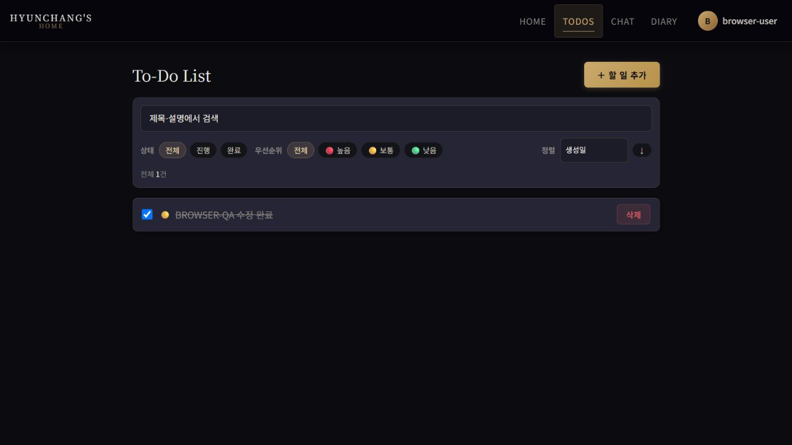
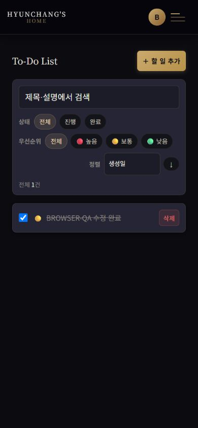
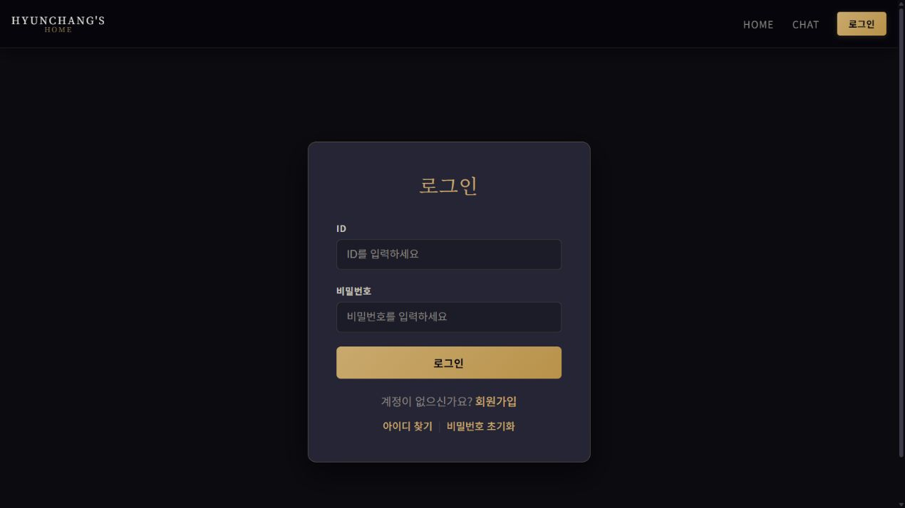

# TEAM-01 후속: 실제 브라우저와 전체 앱 실행 검증

- 상태: 검증 완료 — 결함 2건 발견, 수정은 별도 업무
- 날짜: 2026-11-17
- 요청: 실제 브라우저·전체 앱 실행 검증
- 역할: 기획/검증 verification, 백엔드 개발 planning, 프론트 개발/디자인 design, 브라우저 검증/통합 총괄
- 이전 작업 변경 보존. 운영 서버·DB·실계좌 접근 및 배포 제외.

## 검증 기준

1. 프론트 127.0.0.1:13100, 백엔드 127.0.0.1:13200에서만 실행.
2. 테스트용 H2·가상 사용자 사용, 제품 인증/인가와 핵심 CRUD는 실제 코드로 실행.
3. 백엔드 outbound 차단, 운영 스케줄러·외부 시작 작업 격리. 프론트 API 프록시를 로컬 백엔드로 고정하고 외부 자산/연결을 CSP로 제한.
4. 브라우저에서 공개 화면, 로그인, 할 일 생성/조회/수정/완료, 새로고침, 로그아웃 후 보호 화면 점검.
5. API 검증과 UI 관찰을 구분하고 실패·모의 처리 영역·실행 한계를 기록.

## 결과

실제 Spring Boot/Tomcat, 38개 Repository와 전체 Entity를 H2 메모리 DB에서 기동했고, 실제 Vue 앱을 in-app Chromium 브라우저에서 조작했다. 제품 Auth/User/Todo/메뉴/보안 코드를 사용했다. 운영 서버와 DB에 접속하거나 배포하지 않았다.

### 브라우저 관찰

| 흐름 | 결과 | 증거/설명 |
|---|---|---|
| 로그인 빈 입력 | 통과 | ID 필수 입력 안내 및 제출 차단 |
| 회원가입 비밀번호 불일치 | 통과 | 불일치 문구, 가입 버튼 비활성. 가입 완료는 API에서 검증 |
| 테스트 계정 로그인 | 통과 | browser-user USER 메뉴와 로그인 완료 표시 |
| 공개 홈의 빈 콘텐츠 | 통과 | 테스트 DB에 경력/경험/포트폴리오가 없는 상태 표시 |
| 할 일 생성 | 통과 | `BROWSER-QA 저장 확인`, 상세 설명 저장, 목록 1건 |
| 상세 조회·제목 수정·완료 | 통과 | `BROWSER-QA 수정 완료`, 체크 상태 true, 수정 성공 표시 |
| 새로고침 | 통과 | 로그인 쿠키 복원, 수정된 제목·완료 상태 유지 |
| 모바일 390×844 | 통과(관찰 범위) | 목록·필터·버튼 잘림 없이 표시, 햄버거 메뉴 펼침/메뉴 선택 |
| 진행/완료 필터 | 통과 | 진행 0건, 완료 1건 |
| 로그아웃 | 통과 | 로그아웃 안내, 공개 홈 및 GUEST 메뉴 |
| 비로그인 보호 경로 진입 | 통과 | `/todos`에서 `/login`으로 이동 |
| 비로그인 공개 홈 새로고침 | 실패 | `/`에서도 `/login`으로 이동 — 아래 BUG-02 |
| 브라우저 삭제 | 미실행 | UI 삭제 동작은 실행되지 않음. API 삭제는 별도 통과 |

데스크톱 뷰포트는 기본 크기(약 1280×720), 모바일 확인 후 뷰포트 override를 해제했다. 키보드·스크린리더 접근성 전체 검사나 모든 화면의 반응형 검사는 아니다.

### 독립 API 검증

검증 담당이 로컬 13200에만 요청했다. 서로 다른 쿠키 저장소를 가진 USER 계정 두 개를 사용했다.

| 요청 | 실제 응답 |
|---|---|
| 공개 career | 200, 빈 배열 |
| 비로그인 auth/me, todos | 401 |
| 서로 다른 USER 2명 가입 | 각각 200 |
| 정상 로그인 및 쿠키 auth/me | 200 |
| 틀린 비밀번호 | 400 |
| USER의 관리자 API | 403 |
| Todo 생성·조회·수정·삭제 | 200 |
| 로그아웃 | 200 |
| 로그아웃 후 me, todos, refresh | 모두 401 |

## 발견 사항

### BUG-01 — Todo 사용자별 데이터 분리 없음 (개인 도구 기준 P1)

재현:

1. 계정 A `api-a-9e41d80a`가 할 일 ID 2 생성. 응답의 user는 null.
2. 별도 로그인한 계정 B `api-b-9e41d80a`가 같은 ID 조회 → 200.
3. B가 제목을 `API-SMOKE-B-EDIT-9e41d80a`, 완료 상태를 true로 수정 → 200.
4. A가 다시 조회해 B의 변경을 확인 → 200.

API 검증자는 ID 2만 삭제했고 브라우저의 ID 1은 건드리지 않았다. `TodoService.java:78`은 ID만 조회하고, `:85`의 생성은 사용자를 연결하지 않으며, `:117`의 수정은 소유권을 검사하지 않는다. 프론트와 무관하게 실제 HTTP 요청으로 재현됐다.

개인별 할 일 관리라면 소유자 연결과 모든 조회/수정/삭제/집계의 사용자 범위 제한이 필요하다. 의도된 공유 게시판이라면 공유 정책을 명시해야 한다. 이번 검증에서 제품 정책을 임의 변경하거나 소스를 수정하지 않았다.

### BUG-02 — 공개 홈 새로고침이 로그인으로 이동 (P2)

재현:

1. 로그인 상태에서 로그아웃 → 주소 `/#/`, 공개 홈 표시.
2. 같은 공개 홈에서 브라우저 새로고침.
3. 주소가 `/#/login`으로 바뀌고 로그인 화면 표시.

`src/main.js:21`의 초기 checkAuth 호출이 401이 되면 `src/axios.js:54–55`의 refresh 실패 처리에서 공개 경로도 로그인으로 보낸다. 보호 경로 `/todos`에서 로그인으로 보내는 동작은 정상이며 별도 통과했다.

## 테스트 실행 환경과 제한

- 프론트: `npm run serve:isolated`, loopback13100, API/uploads는13200만 프록시, dotenv 로딩 비활성, 외부 자원 CSP 차단.
- 백엔드: `run-browser-isolated.ps1`, JDK21 시작 시 BrowserNetworkGuard 설치. 외부 소켓/DNS/dotenv/자식 프로세스 차단,13200 loopback 수신만 허용. `BROWSER_GUARD_OK`와 `BROWSER_APP_READY` 확인.
- 기본 sandbox 프로세스는 브라우저의 loopback 요청이 timeout되어 같은 설정/guard를 유지한 권한 확장 실행으로 전환했다. 방화벽·OS 보안 설정이나 공개 바인딩을 변경하지 않았다.
- 외부 시세/AI/공공 API 경계 서비스 8개는 대역, broker HTTP도 실패 대역. 스케줄러·DB migration 2개 제외. H2에서 Todo의 MySQL charset DDL만 테스트 ORM XML로 TEXT에 매핑. Windows selector 소켓 문제를 피하기 위해 Tomcat NIO2 사용.
- 따라서 실제 앱의 핵심 인증·메뉴·CRUD 결합 검증이며 운영 MySQL, 실제 외부 API, 거래, 마이그레이션, 모든 기능의 정상 동작을 보장하지 않는다.
- Bootstrap CDN/외부 웹폰트/지도 자원은 의도적으로 차단했다. 해당 자원에 의한 시각 차이는 운영 UI 결함으로 분류하지 않았다. 공개 홈의 외부 사이트 링크는 클릭하지 않았다.

## 변경 및 인수인계

- 추가: 양쪽 브라우저 전용 런처·설정·문서 및 화면 증거. 제품 src/main과 프론트 src 변경 없음.
- 백엔드 guard 사전검사와 신규 browser Java 선택 Spotless 통과. 기존 전체 verify 스타일 부채는 TEAM-01 기록 그대로 유지.
- 후속: TEAM-07(Todo 데이터 정책/분리), TEAM-08(공개 홈 인증 리디렉션)으로 등록.
- 최종 재검증: 프론트 `test:isolated` 4 suites / 55 tests 통과. 양쪽 `git diff --check` 통과.
- 커밋/푸시/배포 없음. 명령행을 재확인한 테스트 서버 프로세스만 종료했고 13100/13200 리스너가 없음을 확인했다. H2 메모리 데이터는 폐기됐다. 실행법은 양쪽 TESTING.md 및 프론트 scripts/ISOLATED_BROWSER.md 참고.
